# Laporan Resmi Praktikum Jaringan Komputer

## Modul 5: Operation Geofront — Kelompok K-16 (Group A)

### Identitas Kelompok
* **Kelompok:** K-16 (Group A)
* **IP Server Lab / Host (VPN ITS):** `10.4.89.246` (Group A)
* **Alokasi IP Utama (VLSM):** `192.219.0.0/16`

| Nama Anggota | NRP | Pembagian Tugas |
| :--- | :---: | :---: |
| **Afriezal Suryapraba Laiasach** | 5027251096 | Soal 1 – 10 |
| **Muhammad Rifqi Fathurrahman** | 5027251029 | Soal 11 – 20 |

---

### 📌 Daftar Isi
1. [Babak 1: Membangun Geofront (Soal 1 – 8)](#babak-1-membangun-geofront)
2. [Babak 2: Sabotase dan Hantu MAGI (Soal 9 – 12)](#babak-2-sabotase-dan-hantu-magi)
   * [Soal 11: Casper harus jadi hantu](#soal-11-casper-harus-jadi-hantu)
   * [Soal 12: Teknisi yang kelewat semangat](#soal-12-teknisi-yang-kelewat-semangat)
3. [Babak 3: Mengamankan MAGI dan Zona Sensitif (Soal 13 – 19)](#babak-3-mengamankan-magi-dan-zona-sensitif)
   * [Soal 13: Brankas Balthasar](#soal-13-brankas-balthasar)
   * [Soal 14: Jam kunjungan sang pinguin](#soal-14-jam-kunjungan-sang-pinguin)
   * [Soal 15: Banjir ping di pusat komando](#soal-15-banjir-ping-di-pusat-komando)
   * [Soal 16: Pencuri yang mencoba setiap pintu](#soal-16-pencuri-yang-mencoba-setiap-pintu)
   * [Soal 17: Sihir hitam di jalur paket](#soal-17-sihir-hitam-di-jalur-paket)
   * [Soal 18: Gerbang Monolith dan Radar](#soal-18-gerbang-monolith-dan-radar)
   * [Soal 19: Hukuman untuk sang pengkhianat](#soal-19-hukuman-untuk-sang-pengkhianat)
4. [Babak Final: Siap Dihancurkan, Siap Dibangun Lagi (Soal 20)](#babak-final-siap-dihancurkan-siap-dibangun-lagi)
   * [Soal 20: Uji kebakaran Geofront](#soal-20-uji-kebakaran-geofront)

---

## Babak 1: Membangun Geofront

### Soal 1: Markas Tanpa Peta
Perhitungan pembagian IP dengan VLSM untuk 17 LAN dan 16 link antar-router dari kebutuhan terbesar.

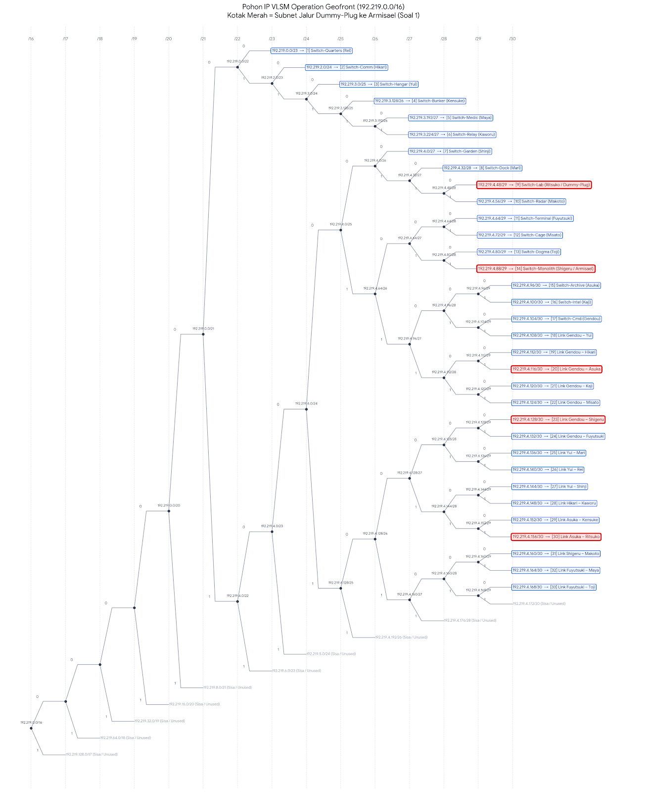

### Soal 2: Geofront Gelap Gulita
Konfigurasi interface IP dan forwarding di router, Gendo terhubung ke NAT1 lewat DHCP.

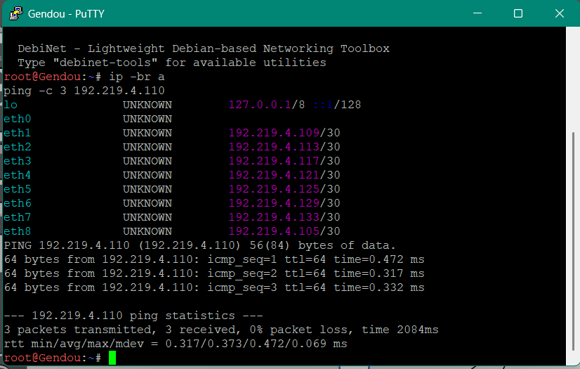

### Soal 3: Pulau-Pulau yang Terpisah
Konfigurasi routing statis hirarki dari Gendo ke cabang-cabang bawahnya.

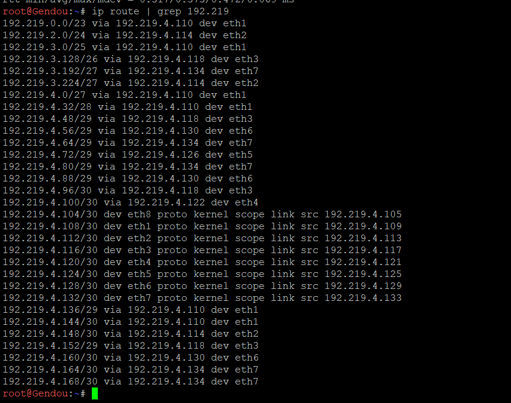
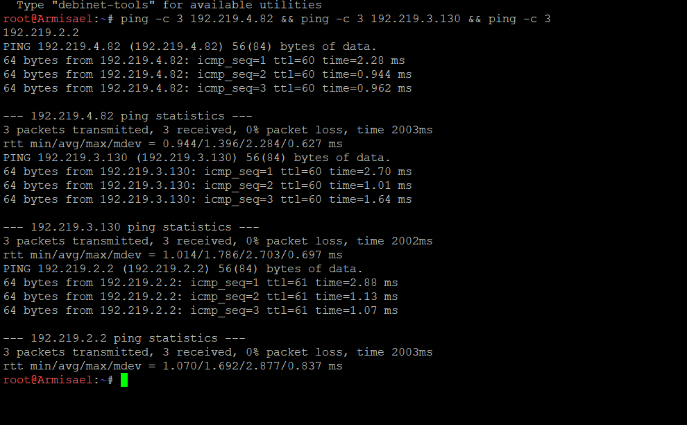

### Soal 4: Haus Kabar dari Dunia Luar
Konfigurasi akses internet seluruh jaringan melalui NAT Masquerade pada router Gendo.

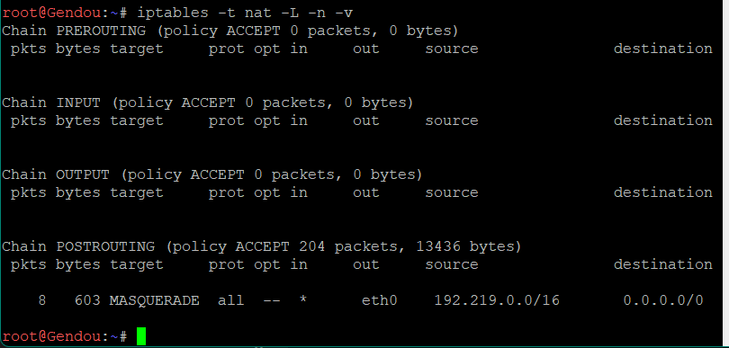
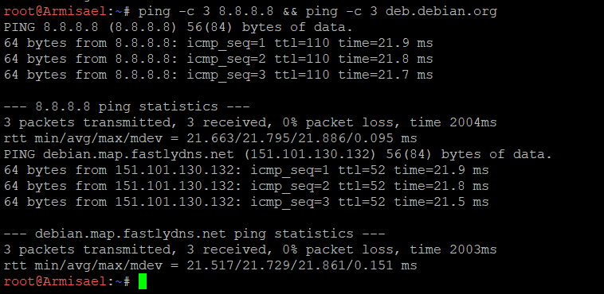

### Soal 5: Pintu Depan Dikunci Rapat
Hardening router Gendo dengan policy INPUT & FORWARD = DROP, mengizinkan balasan koneksi, internal-ke-internet, antar-LAN, dan internal-ke-Gendou.

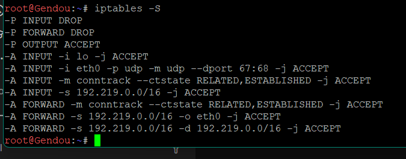
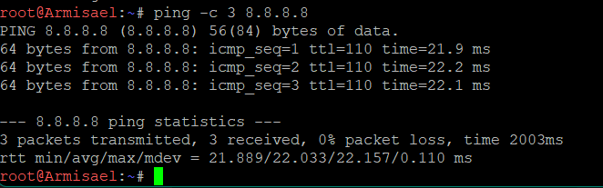

### Soal 6: Alamat Para Pilot
Pemberian IP statis dan gateway permanen untuk semua node non-router.

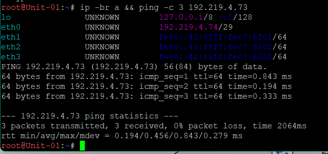

### Soal 7: Membangunkan MAGI
Pemasangan service listener netcat pada node MAGI Casper, Balthasar, dan Melchior di Switch-Terminal.

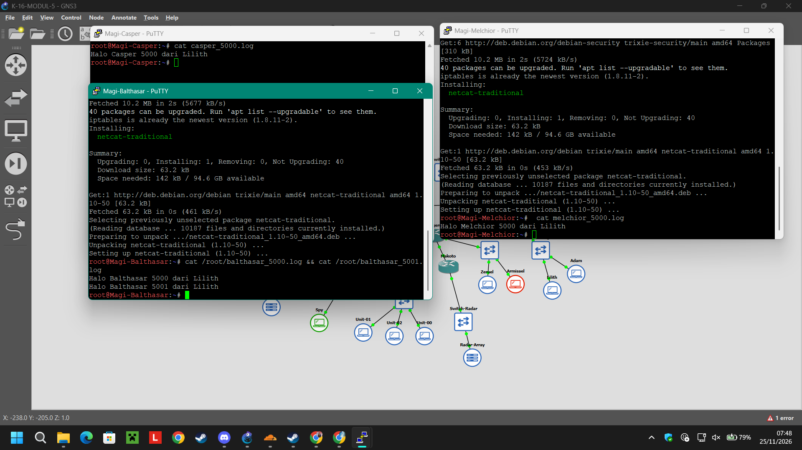
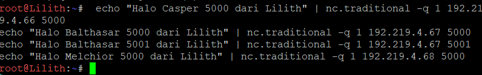

### Soal 8: Mengenali Kondisi Normal
Pengujian layanan normal pada Pen-Pen (port 80) dan Tokyo3-Core (port 80 dan 8080).

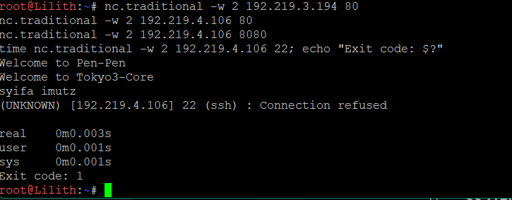

---

## Babak 2: Sabotase dan Hantu MAGI

### Soal 9: Jalur Belakang Diutak-Atik
Troubleshooting sabotase routing di sekitar router Shigeru (`break_routing.sh`).

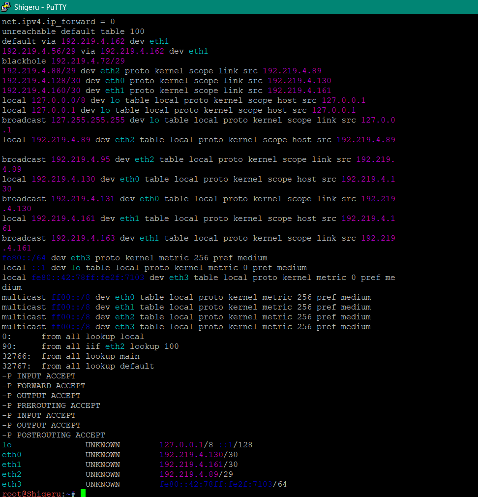
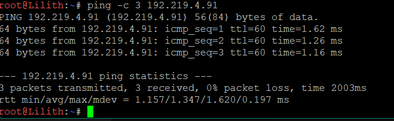

### Soal 10: Para Pilot Terkunci di Dalam
Troubleshooting sabotase NAT di router Misato dan Gendo (`break_nat.sh`).

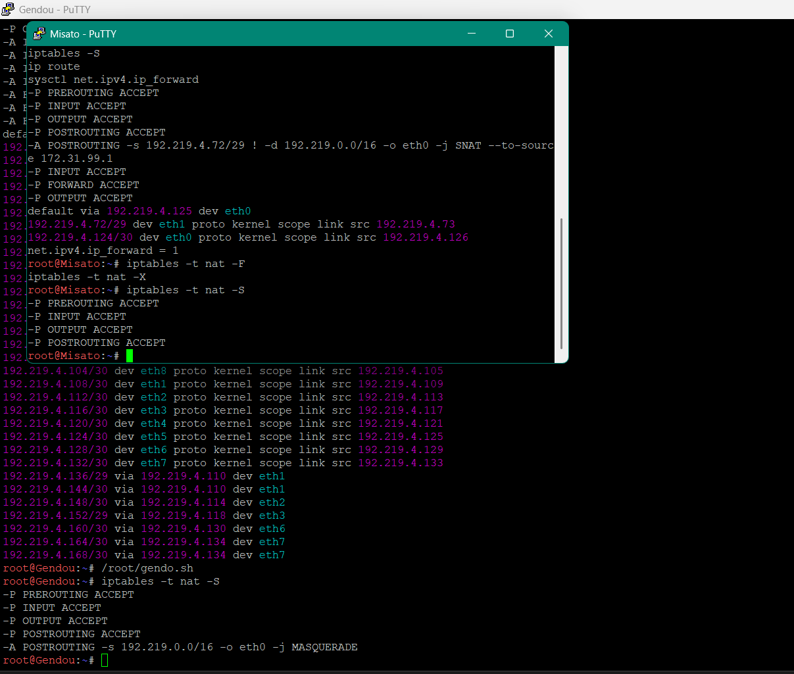
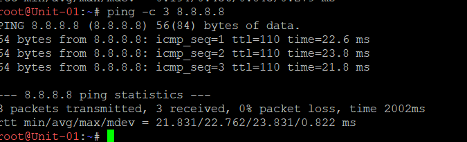

---

### Soal 11: Casper Harus Jadi Hantu

#### Deskripsi Soal:
Casper adalah MAGI paling rahasia. Tidak ada perangkat lain yang boleh mem-ping Casper (termasuk yang satu switch). Namun Casper sendiri tetap boleh mem-ping siapa saja, dan layanan TCP port 5000 di Casper harus tetap hidup.

#### Analisis & Solusi:
Untuk memenuhi syarat ini:
1. Memblokir seluruh paket ICMP tipe `echo-request` (tipe 8) yang masuk ke Casper (`-p icmp --icmp-type echo-request -j DROP`).
2. Mengizinkan paket balasan masuk menggunakan connection tracking (`-m conntrack --ctstate ESTABLISHED,RELATED -j ACCEPT`) sehingga saat Casper nge-ping keluar, paket balasan (*echo-reply*) dapat diterima dengan baik.
3. Memastikan port TCP 5000 tetap diizinkan (`-p tcp --dport 5000 -j ACCEPT`).

#### Script Konfigurasi (`/root/casper.sh`):
```bash
#!/bin/bash
/root/setup_ip.sh

pkill -f "nc" 2>/dev/null
nohup nc -k -l -p 5000 > /root/casper_5000.log 2>&1 &

iptables -F INPUT
iptables -A INPUT -i lo -j ACCEPT
iptables -A INPUT -m conntrack --ctstate ESTABLISHED,RELATED -j ACCEPT
iptables -A INPUT -p tcp --dport 5000 -j ACCEPT
iptables -A INPUT -p icmp --icmp-type echo-request -j DROP
```

#### Hasil Pengujian:
1. **Ping dari Balthasar ke Casper Gagal (100% Packet Loss):**
   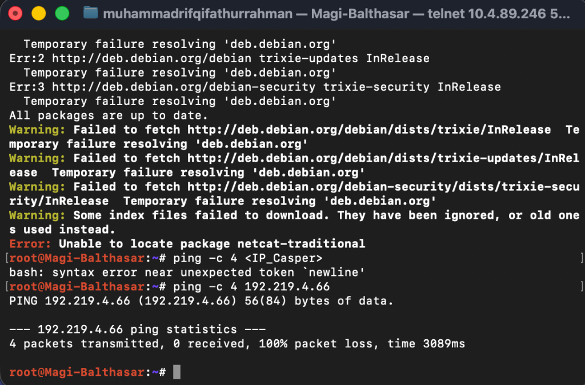

2. **Ping dari Lilith ke Casper Gagal (100% Packet Loss):**
   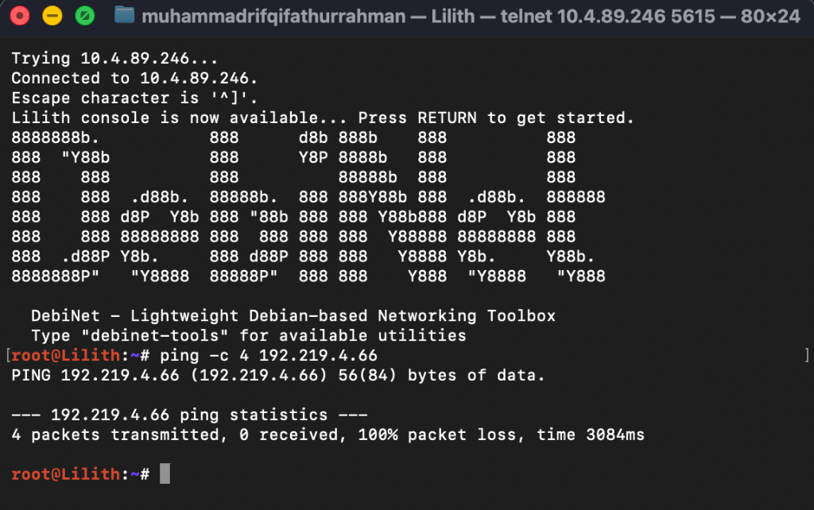

3. **Ping dari Casper ke Balthasar & Lilith Berhasil (0% Packet Loss):**
   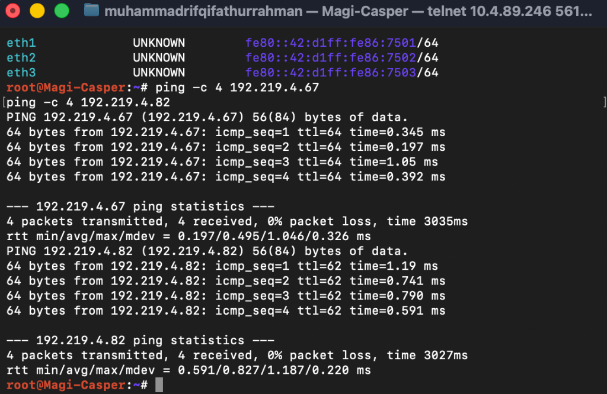

---

### Soal 12: Teknisi yang Kelewat Semangat

#### Deskripsi Soal:
Seorang teknisi menjalankan script `break_fw.sh` di Casper lalu pulang. Paginya Casper tidak bisa ping `8.8.8.8` dan gagal `apt-get update`. Unit-00 juga tidak bisa menyambung ke port 5000 Casper. Perbaiki masalah tanpa membatalkan tujuan hardening (policy INPUT tetap DROP).

#### Analisis Penyebab Masalah:
* Script `break_fw.sh` mendrop port UDP 53 (`OUTPUT -p udp --dport 53 -j DROP`), melumpuhkan fungsi DNS lookup sehingga `apt-get update` gagal me-resolve repository.
* Script mengeset `INPUT DROP` tanpa aturan stateful `ESTABLISHED,RELATED`, sehingga seluruh paket balasan koneksi keluar terbuang.
* Port TCP 5000 tidak di-whitelist di chain INPUT.

#### Solusi Perbaikan di Casper:
```bash
iptables -D OUTPUT -p udp --dport 53 -j DROP
iptables -A INPUT -m conntrack --ctstate ESTABLISHED,RELATED -j ACCEPT
iptables -A INPUT -p tcp --dport 5000 -j ACCEPT
echo "nameserver 8.8.8.8" > /etc/resolv.conf
iptables -P INPUT DROP
```

#### Hasil Pengujian:
1. **`apt-get update` di Casper Berhasil:**
   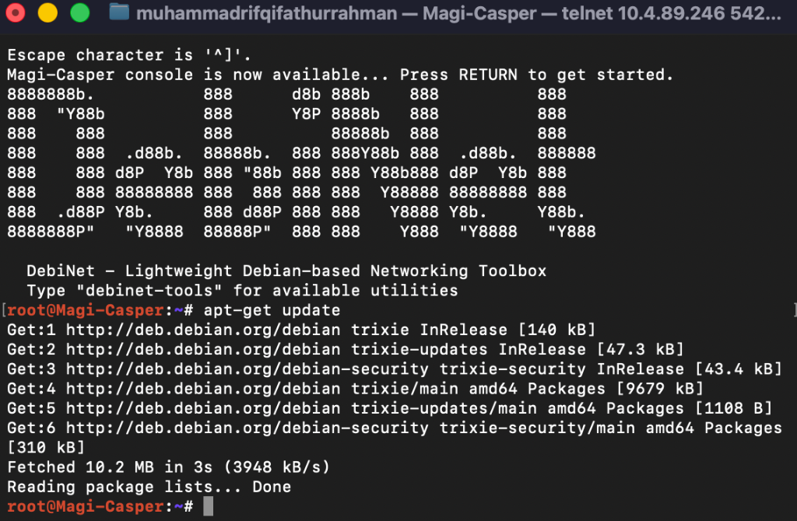

2. **`nc` dari Unit-00 ke Port 5000 Casper Berhasil:**
   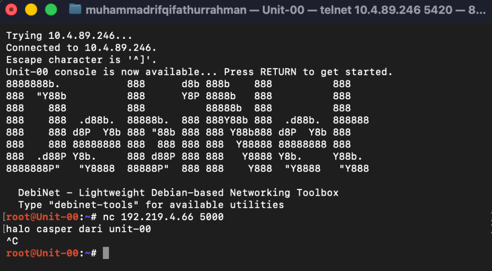

3. **Pesan Masuk di Log Casper & Policy INPUT Tetap DROP:**
   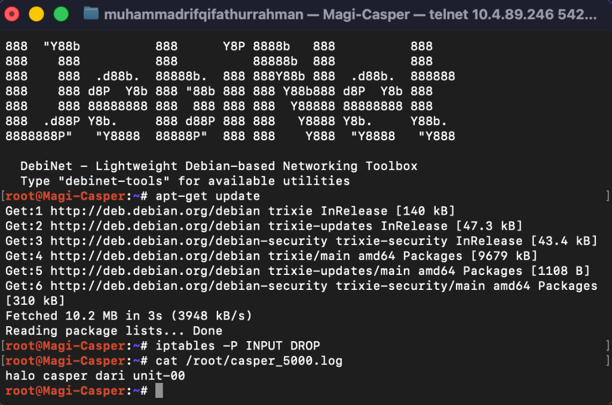

4. **Ping dari Luar ke Casper Tetap Ditolak:**
   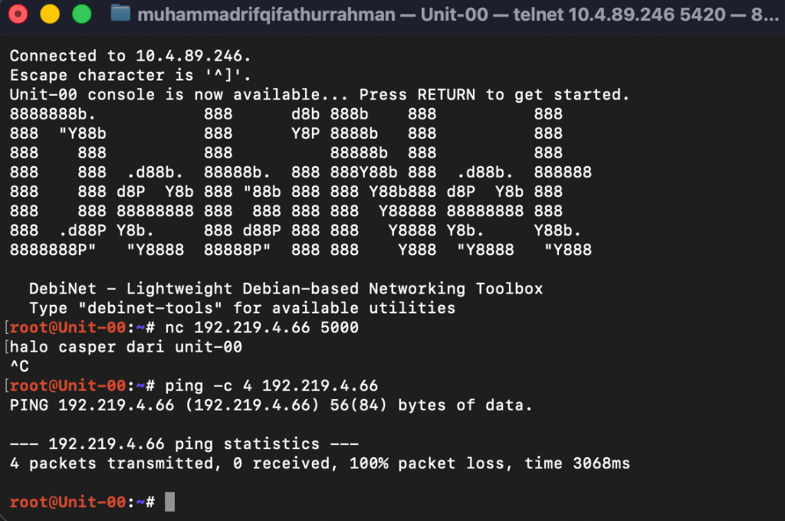

---

## Babak 3: Mengamankan MAGI dan Zona Sensitif

### Soal 13: Brankas Balthasar

#### Deskripsi Soal:
Balthasar menyimpan data Geofront di port TCP 5000 dan 5001. Hanya Casper (`192.219.4.66`) dan semua Pilot (Unit-01, Unit-02, Unit-00, Sachiel) yang boleh menyambung. Node lain (termasuk tetangga satu switch seperti Melchior) harus langsung ditolak seketika (`REJECT` dengan `tcp-reset`). Balthasar harus tetap bisa ping ke internet `8.8.8.8`.

#### Script Konfigurasi (`/root/balthasar.sh`):
```bash
#!/bin/bash
/root/setup_ip.sh

echo "nameserver 8.8.8.8" > /etc/resolv.conf
pkill -f "nc" 2>/dev/null
nohup nc -k -l -p 5000 > /root/balthasar_5000.log 2>&1 &
nohup nc -k -l -p 5001 > /root/balthasar_5001.log 2>&1 &

iptables -F INPUT
iptables -A INPUT -i lo -j ACCEPT
iptables -A INPUT -m conntrack --ctstate ESTABLISHED,RELATED -j ACCEPT

# Whitelist Casper
iptables -A INPUT -p tcp -m multiport --dports 5000,5001 -s 192.219.4.66 -j ACCEPT
# Whitelist Pilot (Cage: Unit-01, 02, 00)
iptables -A INPUT -p tcp -m multiport --dports 5000,5001 -s 192.219.4.72/29 -j ACCEPT
# Whitelist Pilot (Bunker: Sachiel)
iptables -A INPUT -p tcp -m multiport --dports 5000,5001 -s 192.219.3.128/26 -j ACCEPT

# Tolak seketika selain whitelist
iptables -A INPUT -p tcp -m multiport --dports 5000,5001 -j REJECT --reject-with tcp-reset
iptables -P INPUT ACCEPT
```

#### Hasil Pengujian:
1. **Melchior Ditolak Seketika (Exit Code 1 dalam 0 Detik):**
   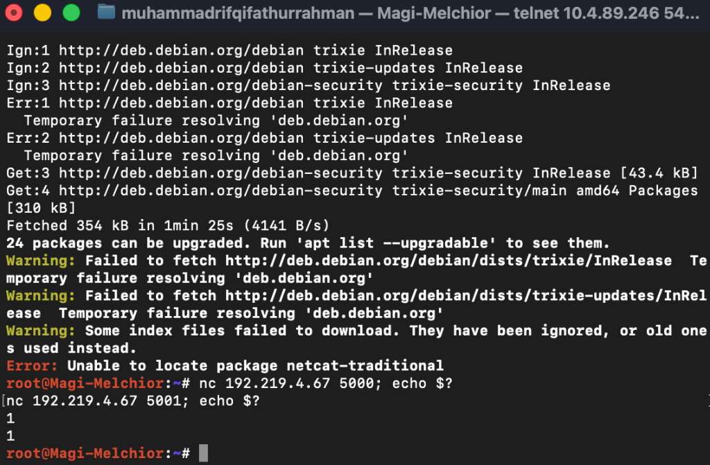

2. **Aturan iptables Balthasar & Sukses Ping 8.8.8.8:**
   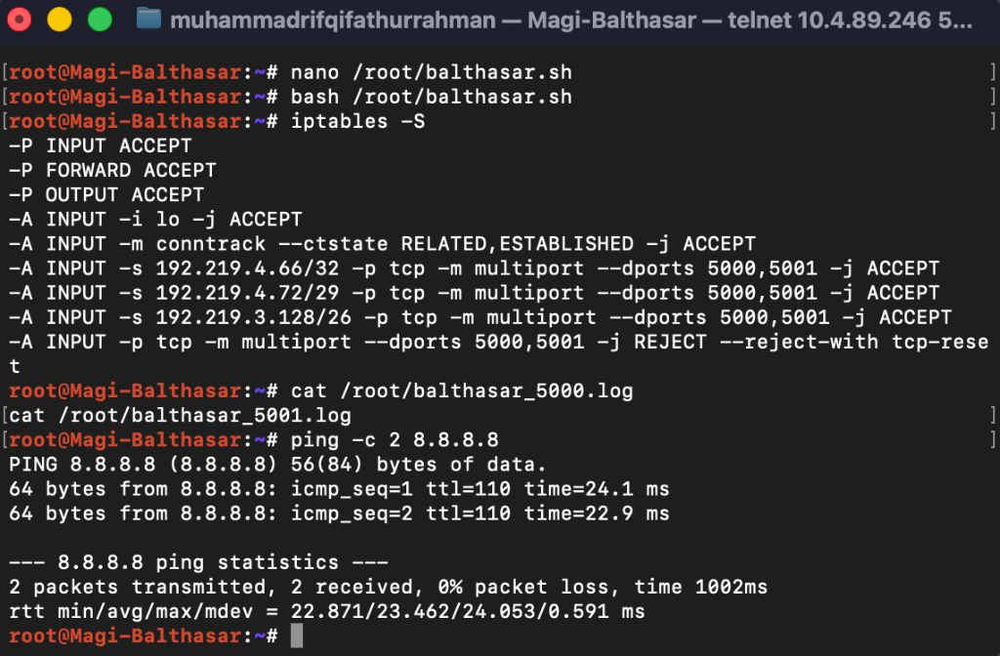

---

### Soal 14: Jam Kunjungan Sang Pinguin

#### Deskripsi Soal:
Pen-Pen hanya boleh dihubungi via Ping dan TCP 80 sesuai jadwal:
* **Pilot:** 08.00 – 16.00 WIB (01:00 – 09:00 UTC), Senin – Jumat.
* **Staf Geofront:** 17.00 – 23.00 WIB (10:00 – 16:00 UTC), Setiap hari.
* **Terduga Dummy System:** Selalu ditolak.
* **Lainnya:** Bebas tanpa batasan.
Jadwal harus disimpan sebagai variabel: `PILOT_START`, `PILOT_STOP`, `PILOT_DAYS`, `STAF_START`, `STAF_STOP`.

#### Script Konfigurasi (`/root/penpen.sh`):
```bash
#!/bin/bash
/root/setup_ip.sh

PILOT_START="01:00"
PILOT_STOP="09:00"
PILOT_DAYS="Mon,Tue,Wed,Thu,Fri"

STAF_START="10:00"
STAF_STOP="16:00"

pkill -f "nc" 2>/dev/null
nohup nc -k -l -p 80 > /root/penpen_80.log 2>&1 &

iptables -F
iptables -X
iptables -P INPUT ACCEPT
iptables -A INPUT -i lo -j ACCEPT
iptables -A INPUT -m conntrack --ctstate ESTABLISHED,RELATED -j ACCEPT

iptables -N CEK_JADWAL
iptables -A INPUT -p icmp --icmp-type echo-request -j CEK_JADWAL
iptables -A INPUT -p tcp --dport 80 -j CEK_JADWAL

# Dummy System selalu ditolak
iptables -A CEK_JADWAL -s 192.219.4.48/29 -j DROP
iptables -A CEK_JADWAL -s 192.219.4.100/30 -j DROP

# Pilot
iptables -A CEK_JADWAL -s 192.219.4.72/29 -m time --timestart "$PILOT_START" --timestop "$PILOT_STOP" --weekdays "$PILOT_DAYS" -j ACCEPT
iptables -A CEK_JADWAL -s 192.219.3.128/26 -m time --timestart "$PILOT_START" --timestop "$PILOT_STOP" --weekdays "$PILOT_DAYS" -j ACCEPT
iptables -A CEK_JADWAL -s 192.219.4.72/29 -j DROP
iptables -A CEK_JADWAL -s 192.219.3.128/26 -j DROP

# Staf Geofront
iptables -A CEK_JADWAL -s 192.219.4.80/29 -m time --timestart "$STAF_START" --timestop "$STAF_STOP" -j ACCEPT
iptables -A CEK_JADWAL -s 192.219.4.80/29 -j DROP

# Lainnya
iptables -A CEK_JADWAL -j ACCEPT
```

#### Hasil Pengujian:
* **Kondisi 1: Jadwal Cocok (Match)**
  * Unit-01 (Pilot) Berhasil Ping (0% Loss):
    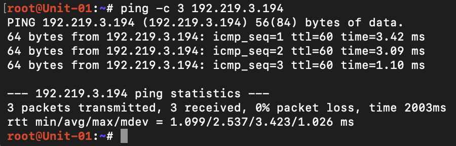
  * Lilith (Staf) Berhasil Ping (0% Loss):
    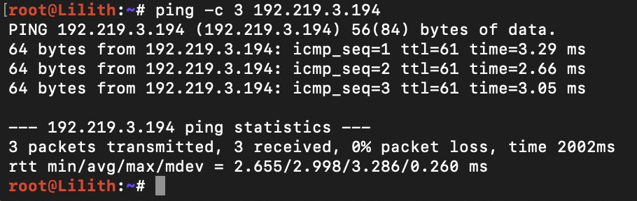
  * Spy (Dummy System) Ditolak (100% Loss):
    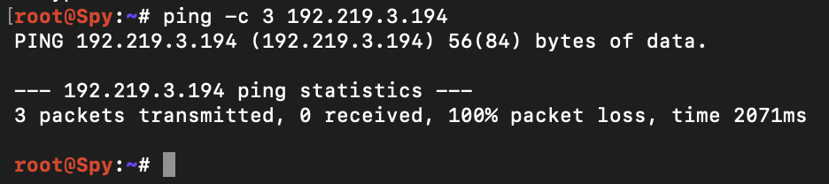

* **Kondisi 2: Jadwal Tidak Cocok (Unmatch)**
  * Unit-01 Ditolak (100% Loss):
    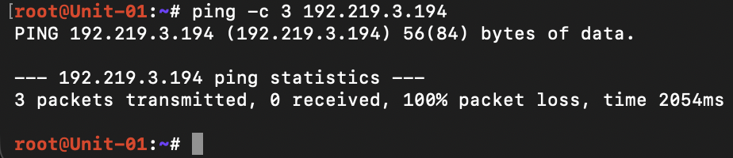
  * Lilith Ditolak (100% Loss):
    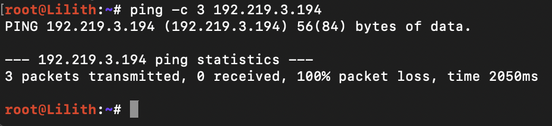
  * Spy Tetap Ditolak (100% Loss):
    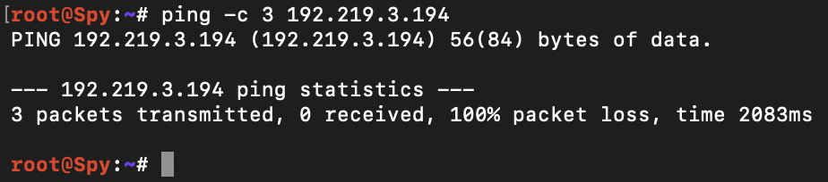

---

### Soal 15: Banjir Ping di Pusat Komando

#### Deskripsi Soal:
Batasi Tokyo3-Core (`192.219.4.106`) agar hanya menjawab maksimal 5 ping per detik (`--limit 5/s`), dan buang kelebihannya. Aturan tidak boleh membatasi ping keluar Tokyo3-Core sendiri. Buktikan ping rapat dari Lilith (`ping -i 0.1 -c 50`) mengalami packet loss dan counter pembuangan di iptables naik.

#### Catatan Teknis (Urutan Rule):
Aturan limit ICMP diletakkan **sebelum** aturan `ESTABLISHED,RELATED` agar paket ping flood susulan tidak otomatis diizinkan oleh connection tracking.

#### Script Konfigurasi (`/root/tokyo3.sh`):
```bash
#!/bin/bash
/root/setup_ip.sh

iptables -F INPUT
iptables -A INPUT -i lo -j ACCEPT

# Rate limit ping masuk (taruh sebelum conntrack)
iptables -A INPUT -p icmp --icmp-type echo-request -m limit --limit 5/s --limit-burst 5 -j ACCEPT
iptables -A INPUT -p icmp --icmp-type echo-request -j DROP

iptables -A INPUT -m conntrack --ctstate ESTABLISHED,RELATED -j ACCEPT
iptables -P INPUT ACCEPT
```

#### Hasil Pengujian:
1. **Ping Banjir dari Lilith Mengalami 40% Packet Loss:**
   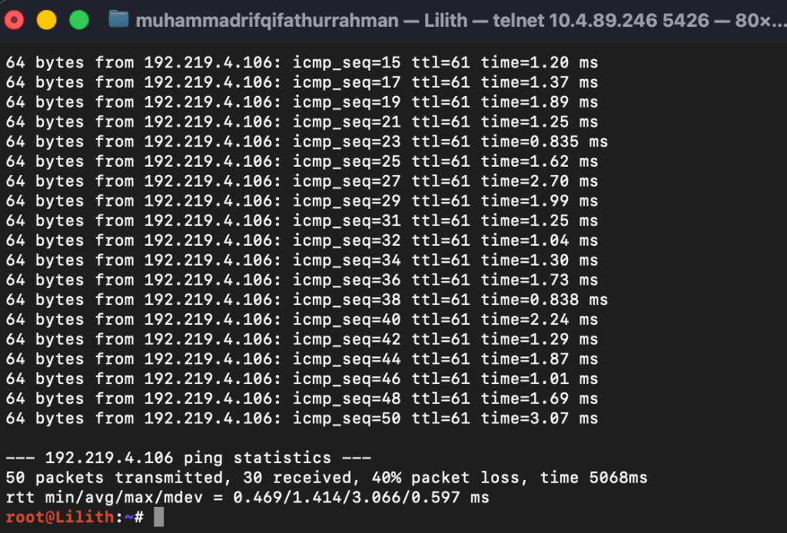

2. **Counter DROP di Tokyo3-Core Naik Tepat 20 Paket (1680 Bytes):**
   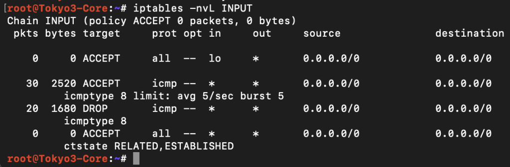

3. **Ping Santai Jeda 3 Detik dari Lilith Berhasil 100% (0% Packet Loss):**
   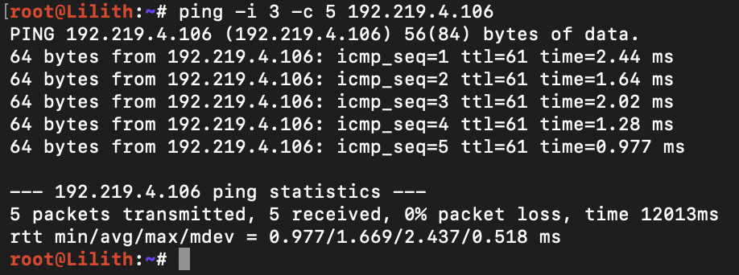

---

### Soal 16: Pencuri yang Mencoba Setiap Pintu

#### Deskripsi Soal:
Setiap koneksi TCP dari Dummy-Plug (`192.219.4.51`) ke port 22, 23, dan 3306 di Tokyo3-Core harus dicatat di log dengan prefix huruf besar `SCAN-NERV: `, lalu ditolak seketika (`REJECT` tcp-reset). Port 80 dan 8080 tetap bisa diakses.

#### Konfigurasi iptables di Tokyo3-Core:
```bash
IP_DUMMY="192.219.4.51"
iptables -A INPUT -s $IP_DUMMY -p tcp -m multiport --dports 22,23,3306 -j LOG --log-prefix "SCAN-NERV: "
iptables -A INPUT -s $IP_DUMMY -p tcp -m multiport --dports 22,23,3306 -j REJECT --reject-with tcp-reset
iptables -A INPUT -p tcp -m multiport --dports 80,8080 -j ACCEPT
```

#### Hasil Pengujian:
Counter pada rule `LOG` dan `REJECT` naik tepat 3 paket saat Dummy-Plug mencoba mengetuk port 22, 23, dan 3306, sementara port 80 dan 8080 tetap menerima koneksi:
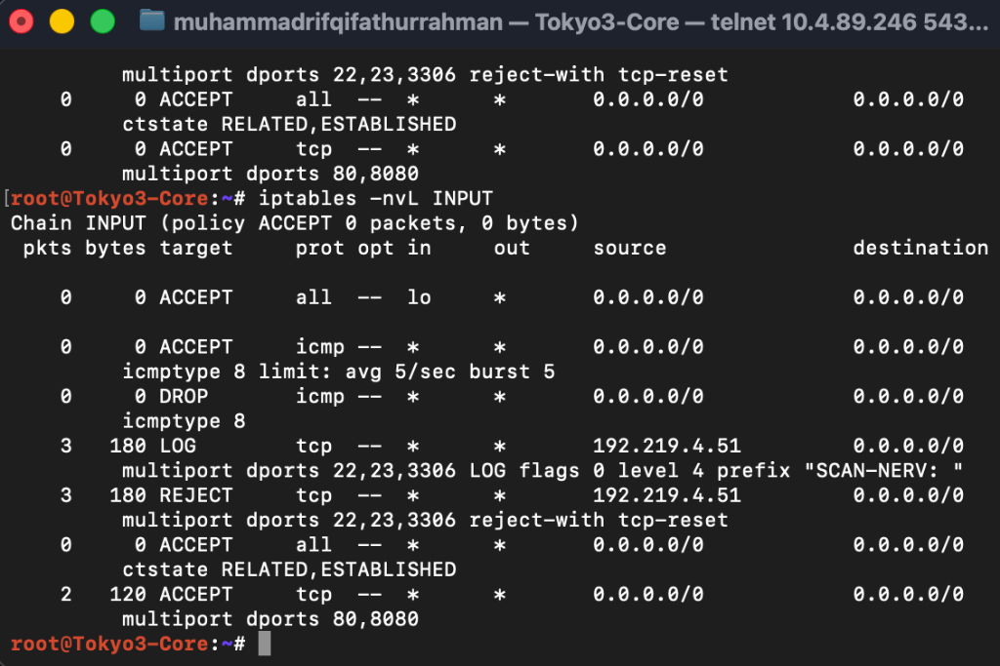

---

### Soal 17: Sihir Hitam di Jalur Paket

#### Deskripsi Soal:
Di router Fuyutsuki, alihkan setiap koneksi TCP dari Magi-Casper (`192.219.4.66`) ke Zeruel (`192.219.4.90`) supaya sampai di Pen-Pen (`192.219.3.194`). Casper tidak boleh sadar dan ping tidak dialihkan.

#### Konfigurasi DNAT di Router Fuyutsuki (`/root/fuyutsuki.sh`):
```bash
iptables -t nat -A PREROUTING -s 192.219.4.66 -d 192.219.4.90 -p tcp -j DNAT --to-destination 192.219.3.194
```

#### Hasil Pengujian:
1. **Pesan Casper ke Zeruel:9000 Muncul di Pen-Pen (Zeruel Bersih Kosong):**
   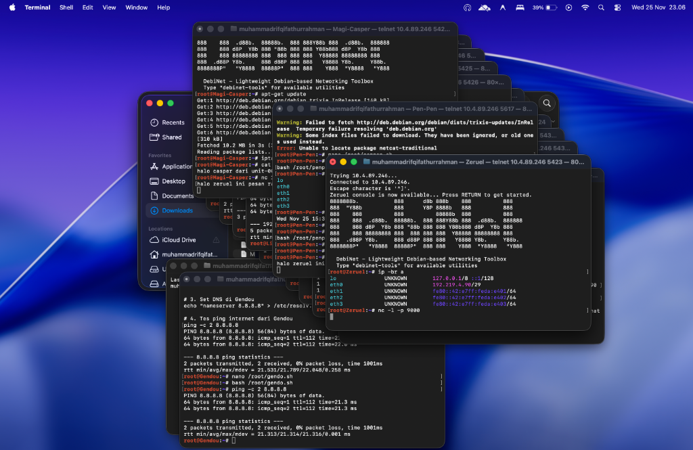

2. **Tabel Conntrack di Fuyutsuki Menunjukkan Translasi DNAT Port 9000:**
   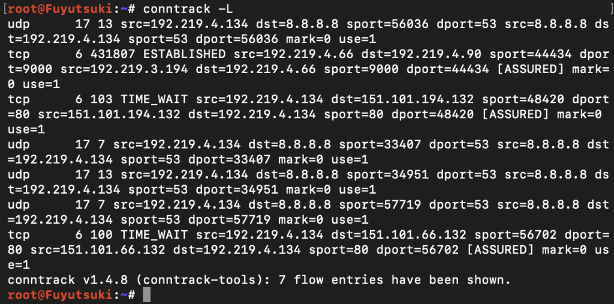

---

### Soal 18: Gerbang Monolith dan Radar

#### Deskripsi Soal:
Pasang aturan di router Shigeru. Node di dalam zona boleh memulai koneksi ke mana saja dan balasannya sampai. Node luar tidak boleh memulai koneksi ke zona, kecuali ping dari subnet Terminal (`192.219.4.64/29`). Penolakan wajib berdasarkan interface yang menghadap Gendo (`eth0`).

#### Konfigurasi Firewall di Router Shigeru (`/root/shigeru.sh`):
```bash
iptables -F FORWARD
iptables -A FORWARD -m conntrack --ctstate ESTABLISHED,RELATED -j ACCEPT
iptables -A FORWARD -i eth0 -s 192.219.4.64/29 -p icmp --icmp-type echo-request -j ACCEPT
iptables -A FORWARD -i eth0 -j DROP
```

#### Hasil Pengujian:
1. **Ping Casper (Subnet Terminal) ke Zeruel Berhasil (0% Loss):**
   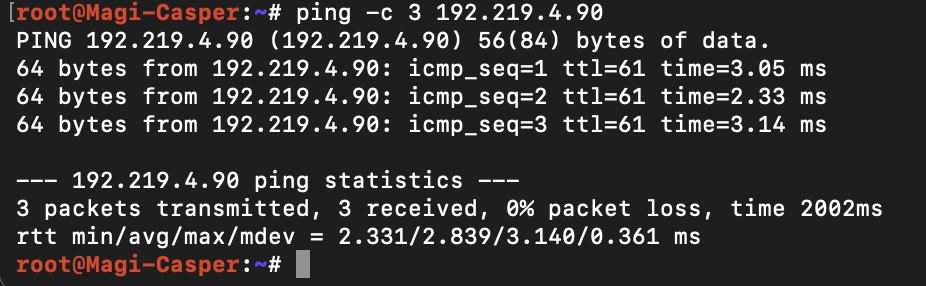

2. **Ping Lilith (Luar Zona) ke Zeruel Ditolak (100% Loss):**
   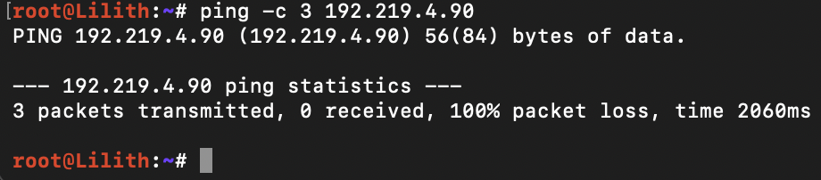

---

### Soal 19: Hukuman untuk Sang Pengkhianat

#### Deskripsi Soal:
Blokir semua lalu lintas masuk dan keluar Armisael (`192.219.4.91`), termasuk ke gateway dan tetangga satu switch. Isolasi tidak boleh dikerjakan di dalam Armisael. Zeruel (`192.219.4.90`) di sebelahnya tidak boleh ikut terhukum.

#### Konfigurasi Isolasi:
1. **Di Router Shigeru (Gateway):**
   ```bash
   iptables -I INPUT -s 192.219.4.91 -j DROP
   iptables -I OUTPUT -d 192.219.4.91 -j DROP
   iptables -I FORWARD -s 192.219.4.91 -j DROP
   iptables -I FORWARD -d 192.219.4.91 -j DROP
   ```
2. **Di Zeruel (Tetangga Switch):**
   ```bash
   iptables -I INPUT -s 192.219.4.91 -j DROP
   iptables -I OUTPUT -d 192.219.4.91 -j DROP
   ```

#### Hasil Pengujian:
1. **Armisael Gagal Total ke Seele, Zeruel, dan Lilith:**
   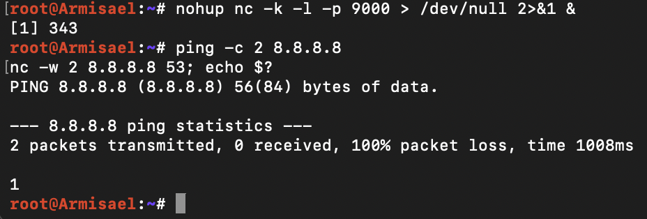
   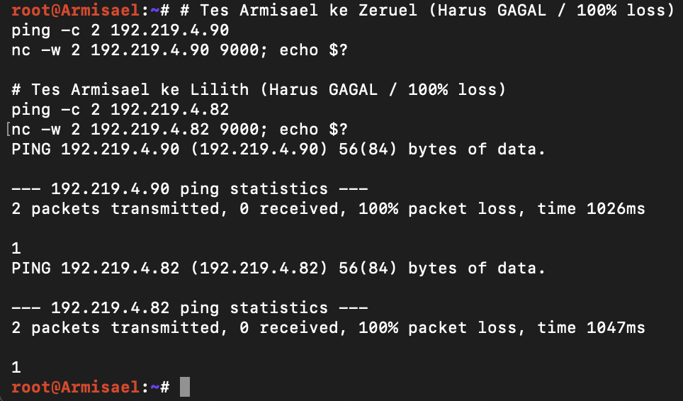

2. **Zeruel Berhasil ke Seele dan Lilith:**
   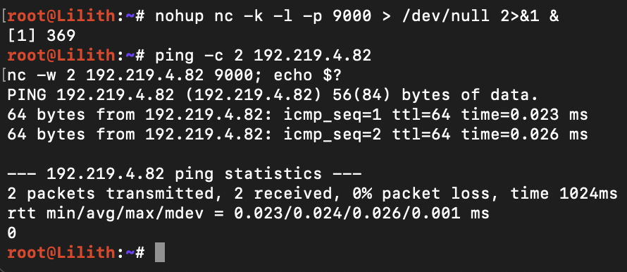
   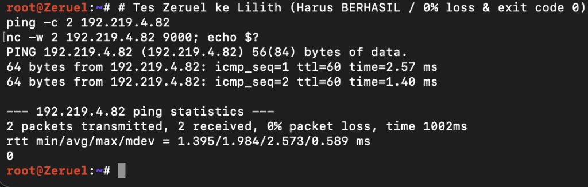

---

## Babak Final: Siap Dihancurkan, Siap Dibangun Lagi

### Soal 20: Uji Kebakaran Geofront

#### Deskripsi Soal:
Pilih tiga node (minimal satu router), simpan rule dengan `iptables-save > /root/<nama>.rules`. Hapus semua rule termasuk nat dan rute manual. Lakukan pemulihan dengan `iptables-restore` dan script `/root/<nama>.sh` sebanyak dua kali berturut-turut untuk membuktikan idempotensi (jumlah baris iptables tidak dobel).

#### Tiga Node yang Diuji:
1. **Router Gendou (`gendo`)**
2. **Host Tokyo3-Core (`tokyo3`)**
3. **Host Pen-Pen (`penpen`)**

#### Prosedur Eksekusi Tiap Node:
```bash
# 1. Backup
iptables-save > /root/<nama>.rules

# 2. Hancurkan
iptables -F && iptables -X && iptables -t nat -F && iptables -t nat -X

# 3. Pemulihan 1
iptables-restore < /root/<nama>.rules && bash /root/<nama>.sh
iptables -S | wc -l
iptables -t nat -S | wc -l

# 4. Pemulihan 2 (Uji Idempotensi)
iptables-restore < /root/<nama>.rules && bash /root/<nama>.sh
iptables -S | wc -l
iptables -t nat -S | wc -l

# 5. Uji Fungsi
ping -c 2 8.8.8.8
```

#### Hasil Pengujian 3 Node:

1. **Router Gendou (Baris Filter = 10, Baris NAT = 5, Ping Sukses):**
   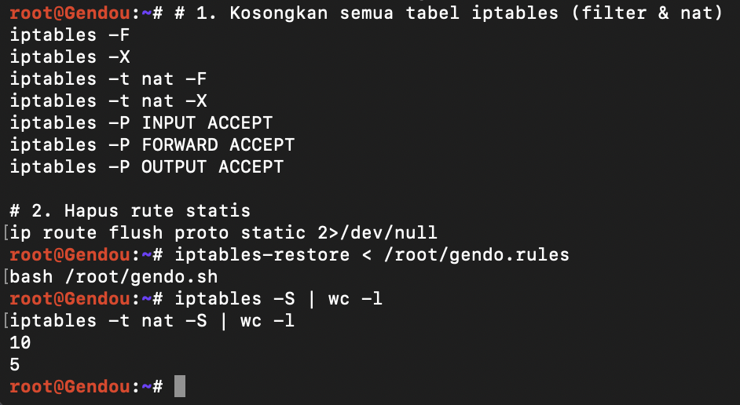
   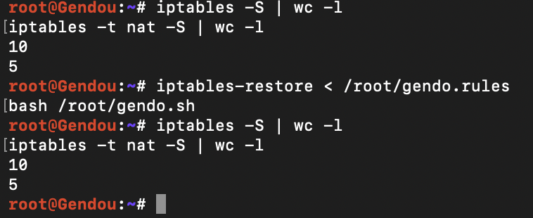
   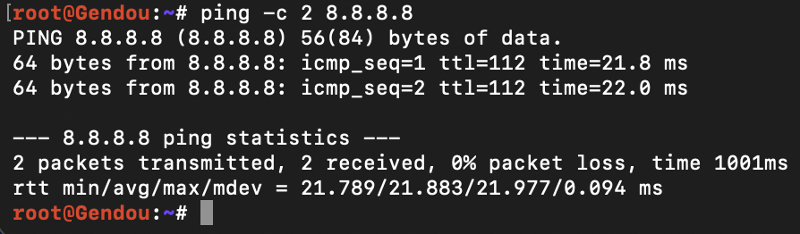

2. **Host Tokyo3-Core (Baris Filter = 10, Baris NAT = 4, Ping Gateway Sukses):**
   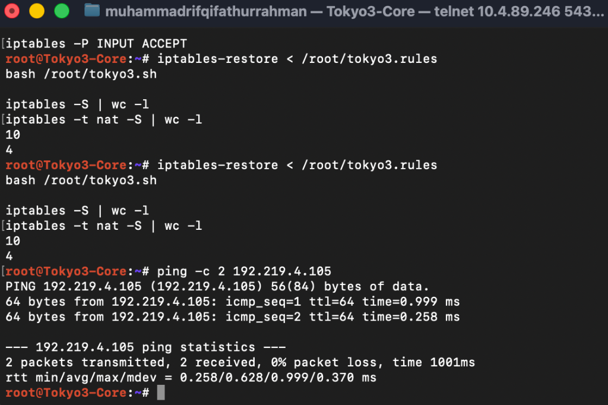

3. **Host Pen-Pen (Baris Filter = 17, Baris NAT = 4, Ping Sukses):**
   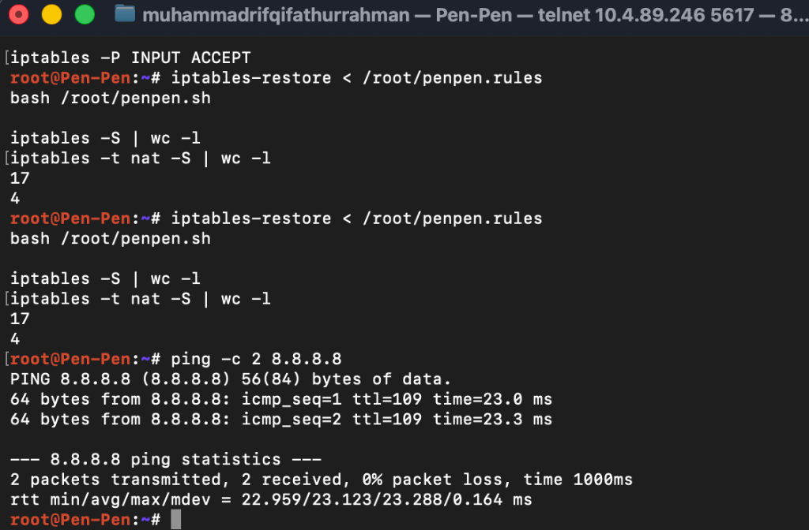
